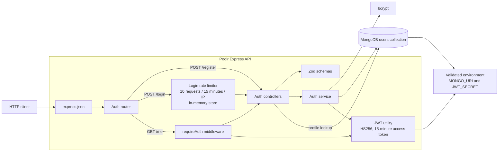
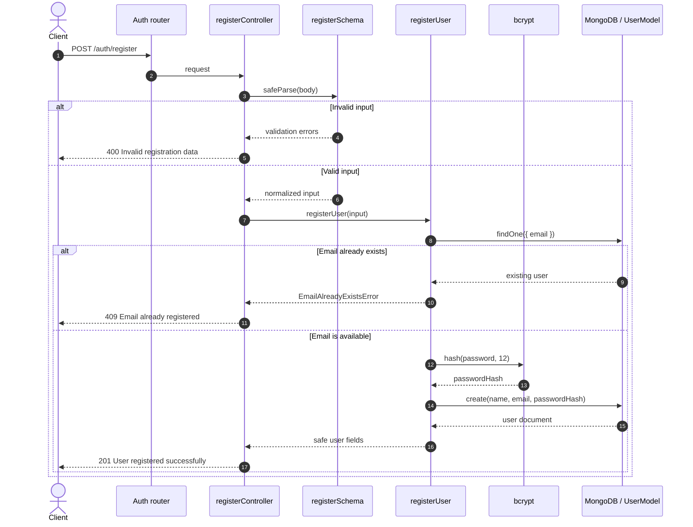
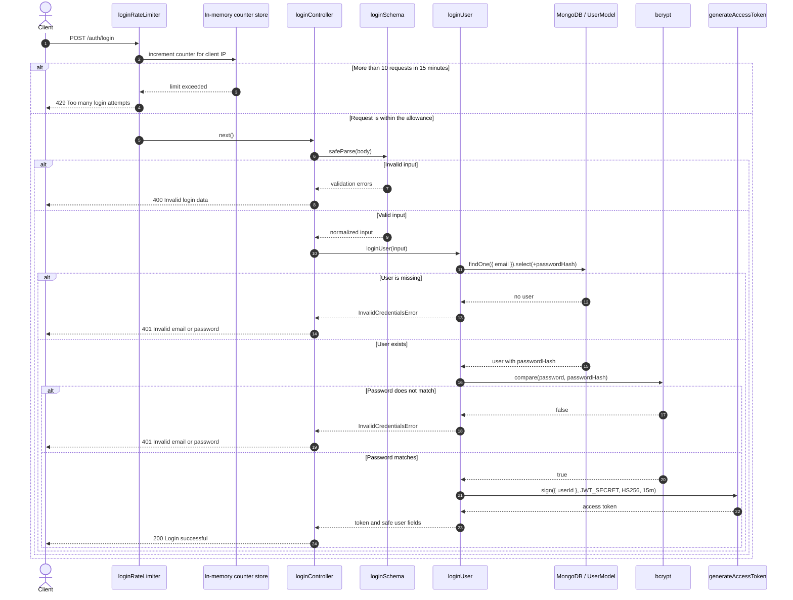
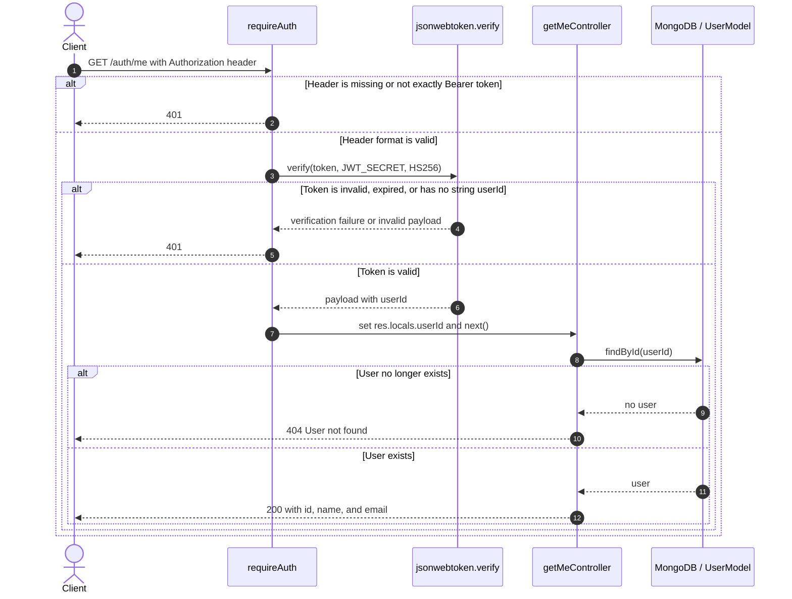

# Authentication architecture

This document describes the authentication implementation currently present in Poolr. It covers registration, login, JWT-protected profile access, environment validation, and login rate limiting as implemented on branch `feat/v0.1-auth-hardening` at commit `9dc33b6`.

## System overview

The Express application installs JSON parsing before mounting the auth router at `/auth`. The router then applies middleware at the individual route level:

| Route | Middleware and handler order | Purpose |
|---|---|---|
| `POST /auth/register` | `registerController` | Validate input, hash the password, and create a user. |
| `POST /auth/login` | `loginRateLimiter` → `loginController` | Enforce the per-IP request allowance before validation or credential work. |
| `GET /auth/me` | `requireAuth` → `getMeController` | Verify a bearer access token before loading the current user. |

At process startup, `validateEnv()` requires a non-empty `MONGO_URI` and a `JWT_SECRET` of at least 32 characters before the database connection is opened or the HTTP server starts listening. JWT signing and verification also reject a missing or short secret at the point of use.

## Registration sequence

Registration trims and constrains the name, normalizes the email to trimmed lowercase, requires a password of at least eight characters, and rejects passwords longer than 72 UTF-8 bytes. The service uses bcrypt with cost factor 12. The Mongoose model excludes `passwordHash` from normal queries, and the response contains only the user ID, name, and email. A MongoDB duplicate-key error on the email index is also translated to HTTP 409, covering a race between the preliminary lookup and insertion.

## Login sequence

The limiter is created by `createLoginRateLimiter(limit = 10)` from `express-rate-limit`. Its fixed window is 15 minutes, it uses the library's default in-memory store and default IP-based keying, emits the combined draft-8 `RateLimit` header, disables legacy `X-RateLimit-*` headers, and returns a stable JSON error body. The tenth request is allowed; the eleventh request from the same resolved IP during the window receives HTTP 429.

Because the limiter precedes `loginController`, every request reaching the login route counts, including malformed requests that later receive HTTP 400. A blocked request never reaches Zod validation, MongoDB, bcrypt, or JWT signing.

## Protected profile sequence

Access tokens are signed with HS256 and expire after 15 minutes. `requireAuth` accepts exactly one `Bearer <token>` credential, pins verification to HS256, validates that the decoded payload contains a string `userId`, and passes that ID through `res.locals`. There is currently no refresh-token, revocation, or logout mechanism.

## Rate-limiter construction and placement

`createLoginRateLimiter()` is a factory rather than only a singleton. Production exports `loginRateLimiter = createLoginRateLimiter()` with the default limit of 10. Focused tests create a fresh limiter with a small limit for each test, preventing counters from leaking between cases and keeping the tests fast. The real-route integration test uses the production singleton and verifies ten HTTP 400 responses followed by one HTTP 429 response.

The limiter is intentionally narrow in scope: it protects only `POST /auth/login`. Registration, `/auth/me`, health checks, and any future routes are not affected by this middleware instance.

## Error and response boundaries

- Registration validation failures return HTTP 400; duplicate emails return HTTP 409.
- Login validation failures return HTTP 400; unknown email and wrong password deliberately share the generic HTTP 401 response `Invalid email or password`.
- Login throttling returns HTTP 429 with `{ "success": false, "message": "Too many login attempts. Please try again later." }`.
- Unexpected registration or login failures return HTTP 500 without exposing internal error details in the response.
- Missing, malformed, invalid, or expired credentials on `/auth/me` return HTTP 401; a valid token for a deleted user returns HTTP 404.

## Verification

At commit `9dc33b6`, `npm test` passes 21 tests across five files, including three focused limiter tests and one real-route limiter integration test. `npm run test:typecheck` also passes.

The rate-limiter tests verify:

- requests at the configured limit are allowed;
- the next request returns HTTP 429 and the expected JSON body;
- the standard `RateLimit` response header is present; and
- the production `/auth/login` route counts malformed requests before controller validation and blocks request 11.

## Current limitations

- The default in-memory store is local to one Node.js process. Counters reset on restart and are not shared across replicas, so the effective allowance increases when traffic is distributed across multiple instances.
- IP-based limiting can group users behind the same NAT and can be evaded by attackers able to rotate source addresses.
- Correct client identification depends on Express proxy configuration matching the deployment topology. `trust proxy` is not configured in the current application.
- The limiter protects the endpoint, not an account identifier. It does not implement progressive delays, CAPTCHA, account lockout, or risk-based controls.
- The middleware counts all login requests, including malformed requests and successful logins; it does not reset a client's counter after successful authentication.
- There is no external store, cross-process coordination, fail-open/fail-closed policy, or limiter observability yet.
- Rate limiting reduces online guessing volume but does not replace strong passwords, secure secret management, monitoring, or broader abuse controls.

