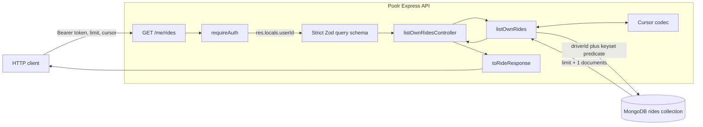
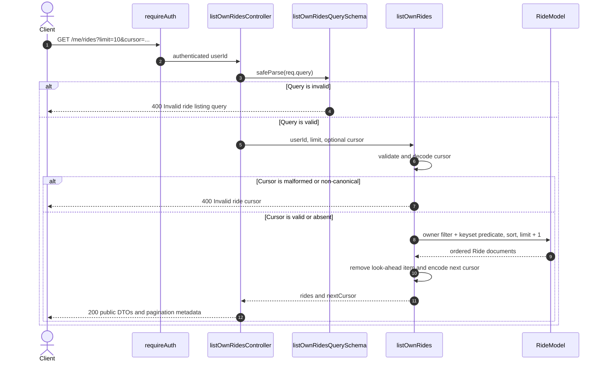

# Driver Ride listing architecture

`GET /me/rides` returns only the authenticated user's own Rides. It uses keyset pagination with a deterministic descending order of `departureTime` followed by `_id`. The default page size is 10 and the maximum is 50.

## Request flow



Authentication happens before query validation or database access. `requireAuth` verifies the access token and places its `userId` in `res.locals`. The controller never accepts a driver ID from the URL or query string. The service always includes that authenticated ID in the MongoDB predicate, so a cursor copied from another account cannot bypass ownership isolation.

## Stable ordering and cursor predicate



For a cursor `(T, I)`, the next-page predicate is:

```text
driverId = authenticatedUserId
AND (
  departureTime < T
  OR (departureTime = T AND _id < I)
)
```

The query sorts by `{ departureTime: -1, _id: -1 }`. MongoDB ObjectIds are unique, so `_id` turns departure time into a total order and prevents tied records from being skipped or repeated at a page boundary. The existing `{ driverId: 1, departureTime: -1 }` index supports the owner and primary ordering fields; MongoDB may perform an in-memory tie sort for rides sharing a departure time until a future migration adds `_id` to the compound index based on measurement.

## Cursor contract

The cursor is an opaque Base64URL-encoded JSON payload containing an ISO UTC `departureTime` and lowercase 24-character ObjectId. Decoding rejects:

- non-Base64URL characters or non-canonical encoding;
- invalid JSON;
- missing or extra payload fields;
- non-canonical timestamps; and
- malformed or uppercase ObjectIds.

The cursor is encoded rather than encrypted. Clients must treat it as opaque. It does not grant access: every request independently applies authentication and the owner predicate.

## Response and page semantics

The service reads one document beyond the requested limit. If the extra document exists, `hasMore` is true and `nextCursor` represents the final returned Ride. Otherwise `hasMore` is false and `nextCursor` is null. Ride documents pass through the same `toRideResponse` mapper used by Ride creation and retrieval, keeping MongoDB fields private and response formatting consistent.

Keyset pagination avoids offset drift and avoids scanning an increasing number of skipped owner records. It does not create a snapshot. A Ride inserted ahead of the current cursor will appear when the client starts again from the first page, which is the intended behavior for this listing.
