# Pickup-only Ride search

`GET /rides/search` lets an authenticated user find scheduled Rides whose stored route passes within a requested straight-line walking distance of a pickup point. This is the v0.1 pickup-only slice; drop-off matching and route-order evaluation remain v0.2 work.

## Request contract

All coordinates use GeoJSON order: longitude first, then latitude.

| Query parameter | Required | Default | Rules |
|---|---:|---:|---|
| `pickupLng` | yes | — | Decimal from -180 through 180 |
| `pickupLat` | yes | — | Decimal from -60 through 60 |
| `maxWalkM` | no | 1000 | Integer from 1 through 3000 |
| `departAfter` | no | current time | ISO 8601 timestamp with an offset |
| `departBefore` | no | 24 hours after `departAfter` | ISO 8601 timestamp with an offset; the window may not exceed 7 days |
| `seats` | no | 1 | Integer from 1 through 8 |
| `limit` | no | 20 | Integer from 1 through 50 |

The query is strict. Unknown fields, including drop-off fields, are rejected rather than silently ignored. A calendar-based client can convert the selected local date into `departAfter` and `departBefore` timestamps; the API contract remains timezone-explicit.

## Request flow

```mermaid
flowchart LR
    Client[Authenticated client]
    Guard[requireAuth]
    Validator[Strict Zod query]
    Candidate[MongoDB candidate filter]
    Exact[Exact Turf distance]
    Rank[Rank and limit]
    Response[Public Ride responses]

    Client -->|GET /rides/search| Guard
    Guard --> Validator
    Validator --> Candidate
    Candidate --> Exact
    Exact --> Rank
    Rank --> Response
```



The fixed `/search` route is registered before `/rides/:id`, so Express never interprets `search` as a Ride ID.

## Candidate filtering

MongoDB first restricts work to Rides that:

- have status `SCHEDULED`;
- have at least the requested available seats;
- depart within the inclusive requested window;
- are not owned by the authenticated requester; and
- have a route intersecting the pickup candidate area.

The candidate area is a 64-step Turf circle with its radius inflated by 1%. A polygon only approximates a true circle, so inflation makes the candidate query a conservative filter: it may admit false positives near the boundary, but the exact stage removes them. The migration-provided `route_2dsphere` index supports the intersection query.

Candidates are initially ordered by departure time and `_id`. The service fetches 501, retains at most 500 for exact evaluation, and returns `truncated: true` when candidate 501 exists. When truncated, ranking applies only to that bounded subset and may not contain the globally closest Rides.

## Exact distance and ranking

For each retained candidate, Turf projects the pickup point onto the nearest point anywhere on the Ride's `LineString`. It then calculates the straight-line distance in metres. A Ride is feasible when the unrounded distance is less than or equal to `maxWalkM`.

Feasible Rides are ranked by:

1. unrounded pickup walking distance, ascending;
2. departure time, ascending; and
3. Ride `_id`, ascending.

The `_id` tie-breaker makes repeated searches deterministic. Distance is rounded to two decimal places only when returned as `walkPickupM`; filtering and ranking use full precision.

## Response shape

Successful searches use the existing public Ride mapper and add the calculated pickup walk:

```json
{
  "success": true,
  "data": {
    "results": [
      {
        "id": "...",
        "driverId": "...",
        "status": "SCHEDULED",
        "route": { "type": "LineString", "coordinates": [] },
        "origin": [77.59, 12.97],
        "destination": [77.60, 12.97],
        "routeLengthM": 1084,
        "departureTime": "2026-11-25T08:00:00.000Z",
        "seatsTotal": 3,
        "seatsAvailable": 3,
        "pricePerSeatPaise": 12000,
        "currency": "INR",
        "priceDisplay": "₹120.00",
        "walkPickupM": 145.32
      }
    ],
    "truncated": false
  }
}
```

Search is top-N only and has no cursor. It does not yet evaluate a drop-off point, pickup-before-drop-off ordering, route trip distance, or pedestrian road-network accessibility.
